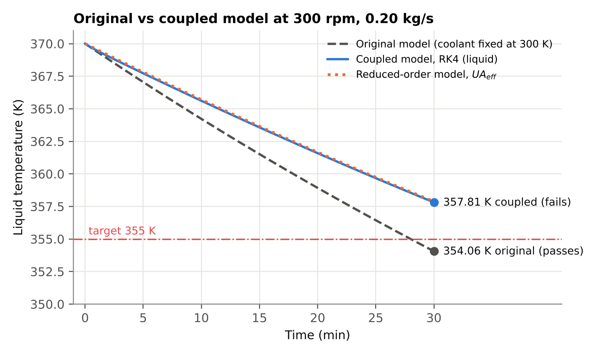
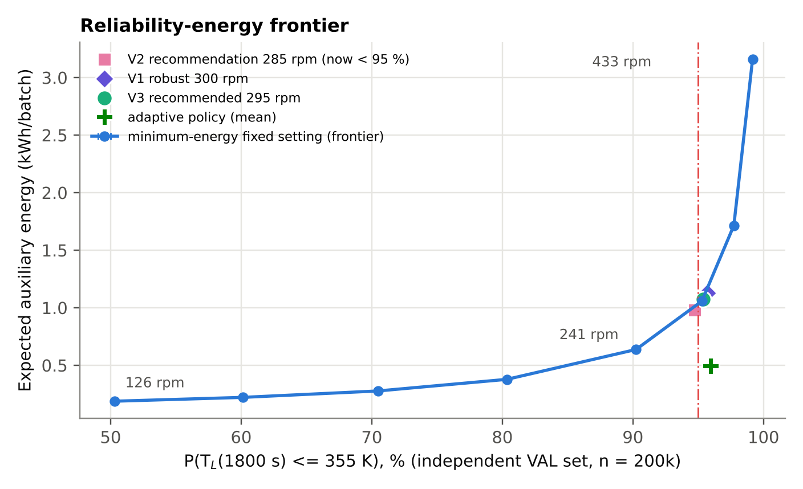

# Jacketed Stirred-Tank Cooling: Dynamic Modelling, Reliability-Based Optimisation and Adaptive Operation

## Project overview

This is an engineering modelling and computational optimisation study of a hot liquid cooled in a jacketed, well-stirred batch tank. It extends a single-equation course model (ESC113M, IIT Kanpur) into a verified two-state liquid–jacket model and uses it to choose an agitator speed and coolant flow under uncertainty.

All results in this repository come from simulation. The uncertain inputs follow **assumed** probability distributions and the heat-transfer coefficient follows an **assumed** scaling law, so every reliability figure below is a simulated probability that holds only under those assumptions. The energy figures are **auxiliary electricity (agitator and pump) only**, not total plant energy. The adaptive operating policy has not been validated experimentally or on an industrial plant. The work is not a validated industrial design.

The Python simulation results and figures are reproducible from fixed random seeds with one command (`python run_all.py`). The optional Octave cross-check and the PDF/DOCX report build are separate commands (see Reproducing the results).

<p align="center"></p>

## Engineering problem

> Which agitator speed and coolant flow cool 500 kg of liquid from 370 K to 355 K within 30 minutes at the lowest auxiliary electricity, and in what fraction of simulated batches does that setting succeed when the heat-transfer coefficient, jacket inventory, delivered coolant flow and initial temperature are uncertain?

The original ESC113M model has one energy balance for a perfectly mixed liquid, with the jacket coolant held at a constant 300 K, solved with the fourth-order Runge–Kutta method (RK4). It treats the jacket as an infinite heat sink and has no operating variables, so it cannot say how hard to stir or how much coolant to pump. The 355 K / 1800 s target is an illustrative design constraint chosen close to the original model's result; it is not a plant specification.

## Model extension

The tank, liquid charge, heat-transfer area, inlet temperature and 1800 s horizon are kept from the original project. The extension adds:

```
M_L Cp_L dT_L/dt = -U A (T_L - T_J)                                   liquid
M_J Cp_C dT_J/dt =  U A (T_L - T_J) + ṁ Cp_C (T_in - T_J)             jacket coolant
U   = U_ref (N/N_ref)^0.25 (ṁ/ṁ_ref)^0.33                             assumed closure
ṁ   = min[ṁ_max, ṁ_cmd (1 + 0.05 z)],  z ~ N(0,1)                      saturated actuator, ṁ_max = 0.50 kg/s
E   = ∫ [N_P ρ n³ D⁵/η_ag + ΔP(ṁ) ṁ/(ρ η_p)] dt / 3.6e6               agitator + pump electricity (kWh)
```

* **Dynamic jacket** with a finite, continuously replenished coolant inventory.
* **Heat-transfer closure** in which U depends on agitator speed and coolant flow. The exponents 0.25 and 0.33 are assumed screening values, and a stress test examines other values.
* **Pump limit.** Commanded flow, delivered flow, pump capacity and flow-loop error are kept distinct. The pump cannot deliver more than 0.50 kg/s, and the pump energy uses the delivered flow.
* **Numerics.** RK4 (Δt = 1 s) integrates every deterministic trajectory. The exact matrix-exponential solution of the linear two-state system verifies RK4 (observed order 4.22; maximum trajectory error 3.2 × 10⁻⁸ K at Δt = 1 s) and evaluates the large Monte Carlo sets. The first law closes to 0.0044 J out of 25.5 MJ.
* **Analyses.** Local and Sobol sensitivity; deterministic and chance-constrained optimisation with separate optimisation (n = 20,000), calibration and validation (n = 200,000) data sets and a one-sided 95 % Wilson lower-bound acceptance rule; a reliability–energy frontier; a simulated adaptive "measure-then-set" policy; a model-form stress test of the heat-transfer closure.
* **Independent implementation** in MATLAB syntax that reproduces the deterministic results. It was executed in GNU Octave 8.4.0, not in MATLAB.

`docs/mathematical_model.md` and `docs/methodology.md` give the details; the detailed report in `reports/detailed_report/` gives the full derivations and results.

## Main findings

All probabilities are fractions of simulated batches under the assumed input distributions.

| Question | Answer (simulation) |
|---|---|
| Does coolant warming matter? | Yes. At 300 rpm and 0.20 kg/s the original model predicts **354.06 K (meets the target)**; the coupled model predicts **357.81 K (misses it)**. The jacket warms to 318.1 K. |
| Why? | The coolant heat-capacity rate acts as a resistance in series with the wall: `1/UA_eff = 1/UA + 1/(ṁ Cp)`. It cuts the effective conductance by 26 %, and this one-line model matches the full simulation to 0.07 K. No agitation speed reaches the target below 0.067 kg/s of coolant. |
| Cheapest setting that meets the target nominally? | 120.1 rpm at the 0.50 kg/s pump limit, 0.185 kWh per batch. It succeeds in only **46.7 %** of simulated uncertain batches. |
| Cheapest setting with 95 % simulated reliability? | **295 rpm at a commanded 0.50 kg/s, 1.076 kWh per batch** of auxiliary electricity. Chosen on 20,000 optimisation samples and checked once on 200,000 independent samples: **P(pass) = 95.39 % (95 % CI 95.29–95.48 %; one-sided lower bound 95.31 %).** |
| What drives the risk? | Sobol indices at the recommended setting: U_ref 73 %, initial temperature 26 %, coolant-flow error 2 %, jacket inventory 0 %. |
| Can measurement replace margin? | In simulation, yes. Estimating UA from 10 minutes of noisy temperature data at 200 rpm and then setting the speed gives **95.97 % reliability (lower bound 95.89 %) at 0.496 kWh mean, 54 % less energy.** 1.27 % of batches hit the 600 rpm cap, the 99th-percentile energy is 5.60 kWh, and the result depends on knowing how U scales with speed. |
| Largest remaining uncertainty? | The heat-transfer closure. If U depended more weakly on the operating variables, the 295 rpm setting would pass only 72 % of simulated batches and no fixed setting within the bounds would reach 95 %. Calibrating U experimentally would be the first step before any practical use. |

<p align="center"></p>

## Repository structure

```
├── run_all.py                    one command: data, figures, outputs, report values
├── src/
│   ├── python/stcool/            model, uncertainty, simulation, optimization, sensitivity,
│   │                             adaptive_policy, plotting, figures, report_values, pipeline, crosscheck
│   └── matlab/                   run_all_matlab.m + supporting_functions/ (MATLAB R2019b+ / GNU Octave 8+)
├── tests/                        pytest suite (41 scientific tests + 7 release checks)
├── data/                         model inputs and simulation-generated results (see data/README.md)
├── figures/                      the ten report figures (PNG)
├── outputs/                      summary_results.csv, validation_results.csv, run_metadata.json, octave_run_log.txt
├── reports/
│   ├── detailed_report/          detailed technical report (PDF, DOCX, LaTeX source)
│   ├── scientific_paper/         3-page two-column paper (PDF, DOCX, LaTeX source)
│   └── build/                    build_reports.py and the generated LaTeX values and tables
├── docs/                         problem statement, model, methodology, assumptions, reproducibility,
│   │                             V2 review response
│   └── original_esc113m/         the original group project (code and report), unchanged
├── LICENSE, LICENSE-CC-BY-4.0.txt, LICENSING.md
├── CITATION.cff, CHANGELOG.md
└── requirements.txt, environment.yml
```

## Installation

Python 3.10 or newer:

```bash
python -m venv .venv
source .venv/bin/activate                # Windows: .venv\Scripts\activate
pip install -r requirements.txt          # or: conda env create -f environment.yml
```

Optional: GNU Octave 8+ or MATLAB R2019b+ for the independent implementation; TeX Live (pdflatex, IEEEtran, booktabs, fancyhdr, enumitem, caption) and pandoc 3+ for rebuilding the reports.

## Reproducing the results

```bash
python run_all.py
```

This regenerates every file in `data/` (except `data/inputs/`), `figures/` and `outputs/`, and the LaTeX value and table files in `reports/build/generated/`. All random numbers come from fixed seeds listed in `data/inputs/datasets.csv`. The figures are drawn by `src/python/stcool/figures.py` from results computed in the same run; the data behind each figure are the CSV files in the matching `data/` subfolder.

**Independent implementation (optional).** Run it first so the Python run can build the cross-check table:

```bash
octave --no-gui --eval "addpath('src/matlab'); run_all_matlab" > outputs/octave_run_log.txt
python run_all.py
```

**Reports (optional).**

```bash
python reports/build/build_reports.py    # both reports, PDF and DOCX
```

**Measured runtime.** From a clean copy with all generated files deleted, on a 2-vCPU Intel Xeon (2.1 GHz) Linux machine with Python 3.13 and NumPy 2.5:

| Stage | Time |
|---|---|
| Octave script (optional) | 11 s |
| `python run_all.py` | 36 s (largest stages: adaptive-policy calibration and validation 11 s, model-form stress test 11 s, reliability–energy frontier 7.5 s) |
| `python -m pytest -q` | 4 s |
| `python reports/build/build_reports.py` (optional) | 7.5 s |
| Complete chain | about 1 minute |

Expect longer times on slower machines; most of the time is spent in vectorised NumPy Monte Carlo evaluations over the 200,000-sample validation sets. A first run in a new virtual environment takes about 10 s longer while Matplotlib builds its font cache.

**What reproduces exactly.** In the clean-copy run every CSV file, figure and generated report table was byte-identical to the committed version; only the recorded runtimes differed. In a fresh virtual environment installed from `requirements.txt`, the CSV files and report tables were again byte-identical and the figures pixel-identical (the PNG bytes can differ with the image-library build).

## Testing

```bash
python -m pytest -q                      # 48 passed
```

The 41 scientific tests (the suite described in the reports) cover the model equations and units, RK4 fourth-order convergence and stability limit, the original ESC113M result, energy closure, the pump limit and actuator saturation, actual-flow pump energy, the optimisation logic and rounding rules, separation and reproducibility of the random data sets, the adaptive policy and its validation protocol, consistency between the Python and MATLAB configurations, and agreement between the stored outputs, this README and the code. Seven release checks cover the licence files, the unchanged original group files, the report metadata, this README's structure and the absence of machine-specific paths.

## Assumptions and limitations

* **Simulation only.** No experimental data were collected or used. Every result is a model prediction.
* **Lumped model.** Perfectly mixed liquid and jacket; no wall heat capacity, heat loss, evaporation or reaction heat.
* **Assumed parameters.** The heat-transfer exponents, power number, efficiencies, loop pressure drop and pump limit are assumed screening values, not vendor or plant data. `docs/assumptions_and_parameters.md` classifies every parameter.
* **Assumed distributions.** The four uncertain inputs are assumed independent and normal. Every reliability figure is conditional on these distributions and on the assumed closure; a weaker heat-transfer dependence would change the recommendation (see Main findings).
* **Energy scope.** The reported energy is auxiliary agitator and pump electricity. Chiller, cooling-tower and heating energy are not included.
* **Adaptive policy.** It is a simulated policy with an assumed sensor-noise level. It has not been validated experimentally or tested on a plant.
* **Illustrative target.** The 355 K / 1800 s constraint is a case-study choice, not a specification.
* **MATLAB code.** Executed in GNU Octave 8.4.0 only.

## References and attribution

**Original project.** The base single-state RK4 model, its parameter set and its analytical comparison come from the ESC113M course project at IIT Kanpur by **ESC113M Group 03**. Their code and report are included unchanged in `docs/original_esc113m/`, with the group's permission. The original files identify the authors as "Group – 03" and do not list individual names.

**V3 extension.** The coupled model, the analyses, the Python and MATLAB/Octave implementations, the tests, the figures, the data and both reports were developed by Nithin D H, Department of Chemical Engineering, IIT Kanpur, through three versions. `CHANGELOG.md` and `docs/v2_review_response.md` record what changed and why. `LICENSING.md` lists what came from where. To cite this work, see `CITATION.cff`.

**Acknowledgement.** The author thanks the members of ESC113M Group 03 for the original project and for permission to include it here.

**References.**

1. T. L. Bergman, A. S. Lavine, F. P. Incropera, D. P. DeWitt, *Fundamentals of Heat and Mass Transfer*, 7th ed., Wiley, 2011.
2. E. L. Paul, V. A. Atiemo-Obeng, S. M. Kresta (eds.), *Handbook of Industrial Mixing*, Wiley-Interscience, 2004.
3. C. Moler, C. Van Loan, Nineteen dubious ways to compute the exponential of a matrix, twenty-five years later, *SIAM Review* 45 (2003) 3–49.
4. A. Saltelli et al., Variance based sensitivity analysis of model output, *Computer Physics Communications* 181 (2010) 259–270.
5. M. J. W. Jansen, Analysis of variance designs for model output, *Computer Physics Communications* 117 (1999) 35–43.
6. J. Luedtke, S. Ahmed, A sample approximation approach for optimization with probabilistic constraints, *SIAM Journal on Optimization* 19 (2008) 674–699.
7. E. B. Wilson, Probable inference, the law of succession, and statistical inference, *JASA* 22 (1927) 209–212.
8. T. H. Chilton, T. B. Drew, R. H. Jebens, Heat transfer coefficients in agitated vessels, *Industrial and Engineering Chemistry* 36 (1944) 510–516.

## Licence

* **Code** (`run_all.py`, `src/`, `tests/`, `reports/build/*.py`): MIT License, see `LICENSE`.
* **Reports, figures, documentation and generated data**: Creative Commons Attribution 4.0 International, see `LICENSE-CC-BY-4.0.txt`.
* **Original ESC113M group materials** (`docs/original_esc113m/`, except its README): not covered by either licence. Copyright remains with ESC113M Group 03; they are redistributed here with permission.

`LICENSING.md` gives the full scope.
